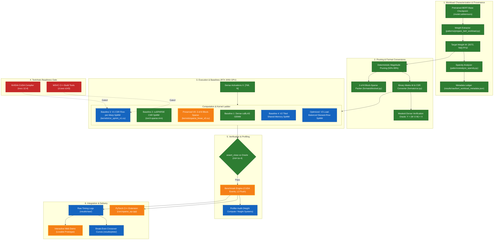

# Custom CUDA Kernel for Sparse Matrix Operations in ML Pipelines

[](docs/ENVIRONMENT_SETUP.md)
[-blue.svg)](requirements-dev.txt)
[](https://pytorch.org/)
[-76B900.svg)](https://developer.nvidia.com/cuda-gpus)
[](tests/)
[](scripts/smoke_test_cuda.py)
[-orange.svg)](https://sparse-cuda-forge.lovable.app/)

> **Project Authoritative Scope:** Project 10, pages 21–22, of *CUDA_GPU_Projects_1-10_Getting_Started.pdf*.  
> **Target Hardware:** NVIDIA GeForce RTX 3050 Laptop GPU (GA107, Ampere Architecture, Compute Capability `sm_86`, 4096 MiB GDDR6 VRAM, 128-bit memory bus).  
> **Development Branch:** `main` | **Active Environment:** Python 3.13.0 64-bit isolated in project `.venv`.

---

## 1. Project Purpose & Executive Summary

In deep learning inference workloads—especially within Transformer feed-forward projections and large language models—unstructured and structured weight pruning produce sparse weight matrices with **50% to 99% zero elements**. While standard dense matrix multiplication (**GEMM** via **cuBLAS**) delivers high arithmetic intensity, it wastes compute cycles and memory bandwidth loading and multiplying zero values. Conversely, general-purpose sparse linear algebra libraries (**cuSPARSE**) are designed for arbitrary graph-oriented irregular sparsity and often exhibit warp divergence, uncoalesced global memory transactions, and high descriptor overhead when applied to deep learning matrices.

The objective of this research and engineering project is to design, implement, profile, and evaluate **workload-specific custom CUDA kernels for Sparse Matrix-Matrix Multiplication (SpMM)** on the NVIDIA Ampere architecture. We systematically evaluate whether custom algorithmic specialization (such as row-per-warp thread assignments, column-coalesced global memory loads, and intra-warp shuffle reductions) can outperform dense cuBLAS and cuSPARSE CSR baselines, establishing the empirical **break-even sparsity crossover point** ($S^*$) where specialization yields measurable execution speedup.

> [!IMPORTANT]
> **Scientific Integrity & Implementation Guard:**  
> This document serves as the project's living implementation ledger. In accordance with strict engineering standards, we clearly distinguish between **verified components**, **scaffolded source code**, and **pending native toolchain prerequisites**. All reported regression tests and smoke tests reflect actual machine execution on the physical RTX 3050 Laptop GPU. No custom CUDA kernel speedup claims or production readiness are asserted prior to completing empirical benchmark sweeps.

---

## 2. Implementation Status at a Glance

The following matrix provides an immediate, verifiable summary of the repository's current development and verification status:

| Project Area | Component / Artifact | Implementation Status | Verification Status & Machine Evidence |
| :--- | :--- | :---: | :--- |
| **Requirements & Traceability** | [Traceability Matrix](docs/REQUIREMENTS.md) & [Architecture](docs/ARCHITECTURE.md) | `COMPLETE & VERIFIED` | Fully traced against Project 10 (R1–R12); memory hierarchy and execution mappings formalised. |
| **Workload Characterization** | BERT-Base Layer 0 Dense Projection (`[3072, 768]`) | `COMPLETE & VERIFIED` | Extracted from `google-bert/bert-base-uncased` (rev `86b5e093`). Native sparsity confirmed at 0.0000%. Metadata tracked in [`results/raw/bert_workload_metadata.json`](results/raw/bert_workload_metadata.json). |
| **Pruning Pipeline** | Deterministic Global Magnitude Pruning | `COMPLETE & VERIFIED` | Stable-sort tie-breaking implemented in [`patterns/prepare_bert_workload.py`](patterns/prepare_bert_workload.py). Official 9-level sweep generated (50% to 99%). |
| **CSR Storage Format** | Bidirectional Converter & Stats | `COMPLETE & VERIFIED` | Dense $\leftrightarrow$ CSR converters and row-length statistics implemented in [`formats/csr.py`](formats/csr.py); 23 unit tests passing. |
| **Block-Sparse Representation** | Preserved 2-of-8 Block Packer | `COMPLETE & VERIFIED` | $32\times 32$ sub-block Frobenius norm selection in [`formats/blocked.py`](formats/blocked.py); 17 unit tests passing on CPU. |
| **CPU Verification Oracle** | Masked-Dense Oracle & Tolerances | `COMPLETE & VERIFIED` | Exact mathematical reference $Y = (W \odot M) \times X$ passing in [`tests/test_formats.py`](tests/test_formats.py) and [`tests/test_workload.py`](tests/test_workload.py) (**71 passed, 1 skipped**). |
| **PyTorch GPU Runtime** | PyTorch `2.6.0+cu124` on RTX 3050 | `COMPLETE & VERIFIED` | Isolated in `.venv`; detected `sm_86`, 4096 MiB VRAM; tensor allocation and device sync passing (**Test A passed**). |
| **Dense GPU Computation** | cuBLAS Dense GEMM Backend | `COMPLETE & VERIFIED` | FP32 and FP16 dense GEMM verified against CPU reference with `assert_close` (**Test B passed**). |
| **cuSPARSE CSR Baseline** | GPU Sparse Matrix Multiplication | `COMPLETE & VERIFIED` | PyTorch cuSPARSE CSR SpMM verified on GPU at 79.3% sparsity vs dense reference (**Test D passed**). |
| **Custom Kernel V0** | Preserved Block-Sparse Prototype | `SOURCE EXISTS — UNVERIFIED` | CUDA source preserved in [`kernels/sparse_linear_v0.cu`](kernels/sparse_linear_v0.cu); native compilation blocked on toolchain. |
| **Custom Kernel V1** | CSR Row-per-Warp SpMM | `DESIGN RECONCILED — PLANNED` | Column-Coalesced Mapping B ($100\%$ coalesced 128-byte transactions) specified in [Architecture](docs/ARCHITECTURE.md); implementation scheduled for Phase 3. |
| **Native CUDA Compilation** | Host `nvcc` & MSVC `cl.exe` | `BLOCKED` | Native compiler tools missing from host PATH; gated on installing VS 2022 Build Tools and CUDA Toolkit 12.4 (**Test C blocked**). |
| **C++/CUDA Extension Build** | PyTorch `CUDAExtension` Toolchain | `BLOCKED` | Build harness in [`python/build_extension.py`](python/build_extension.py) and [`csrc/`](csrc/); compilation blocked on `cl.exe` and `CUDA_HOME` (**Test E blocked**). |
| **Benchmarking Suite** | CUDA Event Timing & L2 Eviction | `IMPLEMENTED — UNVERIFIED` | Measurement harnesses in [`bench/`](bench/); full parameter sweeps gated on custom kernel readiness. |
| **Interactive Demo** | Web Visualization Prototype | `PROTOTYPE (SIMULATED DATA)` | Hosted at [sparse-cuda-forge.lovable.app](https://sparse-cuda-forge.lovable.app/); visual prototype only, benchmark numbers are simulated. |

---

## 3. Research Problem & Theoretical Motivation

### 3.1 The Computational Dilemma of Dense vs. Sparse Inference
Modern deep learning architectures demand billions of floating-point operations per forward pass. Dense linear layers compute:

$$Y = X \times W^T \quad \Longleftrightarrow \quad Y = A \times X$$

Dense matrix multiplication (**cuBLAS GEMM**) achieves near-peak computational efficiency on modern GPUs by maximizing **arithmetic intensity** (FLOPS performed per byte of DRAM traffic) using register tiling and Tensor Cores. When a model is pruned to 80% sparsity, 80% of those multiply-accumulate operations compute zero products ($0 \times x = 0$).

However, sparse matrix multiplication (**SpMM**) is not automatically faster than dense computation. Transitioning from dense arrays to compressed formats introduces severe hardware penalties on GPUs:

1. **Memory Divergence & Uncoalesced Transactions:** Nonzero elements are irregularly distributed across columns. Threads loading nonzeros from DRAM can request non-contiguous memory addresses, causing cache thrashing and memory bus underutilization.
2. **Metadata Processing Overhead:** Sparse formats store column indices (`col_indices`) and row offsets (`row_ptr`). Accessing index metadata consumes memory bandwidth that could otherwise carry numerical weights.
3. **Load Imbalance & Warp Divergence:** When different rows contain unequal numbers of nonzero elements (row-length skewness), threads within a 32-thread warp experience branch divergence. The warp remains stalled until its longest row finishes computation.
4. **Format Packing Latency:** Converting dense weight tensors into sparse formats incurs CPU/GPU preprocessing overhead, requiring offline amortisation across many inference queries.

### 3.2 Core Research Objective
The goal of this project is to implement a workload-specialized CSR SpMM kernel that addresses these bottlenecks through architectural co-design (coalesced column assignments, warp-level reductions, and shared-memory staging) and empirically identify the **break-even sparsity crossover threshold ($S^*$)** where custom sparse execution outperforms dense cuBLAS on commodity Ampere GPUs.

---

## 4. Target Workload & Experimental Methodology

### 4.1 Workload Selection: BERT-Base Uncased
Rather than relying solely on synthetic random matrices, this project anchors its primary investigation to a real transformer weight matrix extracted from **BERT-Base Uncased** (Apache-2.0 license):

- **Model Repository:** `google-bert/bert-base-uncased`
- **Pinned Checkpoint SHA:** `86b5e0934494bd15c9632b12f734a8a67f723594`
- **Target Layer Key:** `bert.encoder.layer.0.intermediate.dense.weight`
- **Matrix Dimensions:** $M = 3072$ (output features), $K = 768$ (input hidden dimension)
- **Total Elements:** $3072 \times 768 = 2,359,296$ parameters ($9.00\text{ MB}$ in FP32)
- **Original Native Sparsity:** **0.0000%** (exactly zero zero-valued elements)

### 4.2 Mathematical SpMM Formulation
During forward inference, token activations $X$ are multiplied by the sparse weight matrix $A_{\text{sparse}}$:

$$Y[3072, N] = A_{\text{sparse}}[3072, 768] \times X_{\text{dense}}[768, N]$$

Where the token batch dimension $N$ is systematically swept across realistic inference batch sizes:
$$N \in \{16, 32, 64, 128, 256, 512\}$$

### 4.3 Deterministic Global Magnitude Pruning Sweep
To evaluate kernel performance across varying degrees of sparsity, deterministic global magnitude pruning is applied to the extracted BERT tensor. The retention policy preserves the exact top-$k$ elements with the largest absolute magnitude $|W_{ij}|$, with stable-sort tie-breaking by flattened row-major index:

$$k = \mathrm{round}\Big(M \times K \times (1.0 - S)\Big)$$

The official parameter sweep spans nine discrete sparsity levels $S \in \{50\%, 60\%, 70\%, 80\%, 85\%, 90\%, 95\%, 98\%, 99\%\}$:

| Target Sparsity ($S$) | Retained Nonzeros ($NNZ$) | Magnitude Threshold ($\tau$) | Row Nonzeros (Min / Max) | Row Nonzeros (Mean ± Std) | Empty Rows | $8\times 8$ Block Sparsity | $32\times 32$ Block Sparsity |
| :---: | :---: | :---: | :---: | :---: | :---: | :---: | :---: |
| **0% (Dense)** | 2,359,296 | 0.000000 | 768 / 768 | 768.0 ± 0.0 | 0 | 0.00% | 0.00% |
| **50%** | 1,179,648 | 0.024712 | 89 / 576 | 384.0 ± 44.5 | 0 | 0.00% | 0.00% |
| **60%** | 943,718 | 0.030904 | 47 / 538 | 307.2 ± 46.5 | 0 | 0.00% | 0.00% |
| **70%** | 707,789 | 0.038196 | 30 / 492 | 230.4 ± 45.3 | 0 | 0.00% | 0.00% |
| **80%** | 471,859 | 0.047479 | 7 / 433 | 153.6 ± 39.3 | 0 | 0.00% | 0.00% |
| **85%** | 353,894 | 0.053516 | 4 / 382 | 115.2 ± 34.2 | 0 | 0.01% | 0.00% |
| **90%** | 235,930 | 0.061454 | 2 / 338 | 76.8 ± 27.5 | 0 | 0.15% | 0.00% |
| **95%** | 117,965 | 0.073820 | 0 / 276 | 38.4 ± 18.1 | 5 | 4.20% | 0.00% |
| **98%** | 47,186 | 0.088522 | 0 / 226 | 15.4 ± 10.4 | 57 | 28.46% | 0.00% |
| **99%** | 23,593 | 0.098763 | 0 / 180 | 7.7 ± 7.1 | 172 | 53.31% | **0.00%** |

### 4.4 Crucial Finding: Element vs. Block Sparsity in Unstructured Pruning
A vital empirical finding documented in [`docs/WORKLOAD_CHARACTERIZATION.md`](docs/WORKLOAD_CHARACTERIZATION.md) and tracked in [`results/raw/bert_workload_metadata.json`](results/raw/bert_workload_metadata.json) is that **under unstructured magnitude pruning, 100% of the 2,304 $32\times 32$ sub-blocks contain nonzero elements even at 99% element sparsity**. 
Because no $32\times 32$ block is completely empty, Blocked Compressed Sparse Row (**BSR**) algorithms cannot skip entire blocks without introducing structural approximations. This rigorously validates **CSR** as the primary mathematical format for unstructured transformer pruning.

*(Note: Model-level task accuracy retention, such as GLUE/SQuAD benchmark validation, is not evaluated in this kernel-latency study; weights are pruned strictly to establish representative matrix patterns).*

---

## 5. End-to-End System Architecture

The following diagram illustrates the complete project pipeline, clearly delineating implemented, blocked, and planned components:



---

## 6. What Is Implemented & Verified Today

The repository contains functional, verified software across the data engineering, format transformation, and CPU/GPU validation tiers:

### 6.1 Repository Organization & Hygiene
- Synchronized with GitHub remote at commit [`9ff8439`](https://github.com/SHIVAJIJAMADAR/Custom-CUDA-Kernel-for-Sparse-Matrix-Operations-in-ML-Pipelines/commit/9ff8439).
- Strict Git hygiene enforced via [`.gitignore`](.gitignore): raw checkpoint weights (`*.safetensors`, `*.pt`), local `.venv/`, and build artifacts are excluded.
- Pristine preservation of the original mid-semester prototype archived in [`sparse-cuda-midsem/`](sparse-cuda-midsem/).

### 6.2 Workload Preparation & Provenance Engine
- [`patterns/prepare_bert_workload.py`](patterns/prepare_bert_workload.py): Reproducibly downloads and extracts the BERT intermediate dense layer from Hugging Face Hub, performs stable-sort tie-breaking pruning, and records full cryptographic provenance in [`results/raw/bert_workload_metadata.json`](results/raw/bert_workload_metadata.json).

### 6.3 Compressed Sparse Row (CSR) Engine
- [`formats/csr.py`](formats/csr.py): Implements dataclass `CSRMatrix`, dense-to-CSR conversion (`dense_to_csr`), CSR-to-dense reconstruction (`csr_to_dense`), and row-length analysis (`row_length_stats`) computing minimum, maximum, mean, median, standard deviation, and coefficient of variation ($CV$).

### 6.4 Block-Sparse Packing Engine
- [`formats/blocked.py`](formats/blocked.py): Implements mid-semester 2-of-8 block-sparse packing (`pack_2of8_block_sparse`) and unpacking (`unpack_2of8_block_sparse`), partitioning matrices into $32\times 32$ blocks across 8-block groups and retaining the top-2 sub-blocks by Frobenius norm.

### 6.5 Sparsity Analysis Tool
- [`patterns/analyze_sparsity.py`](patterns/analyze_sparsity.py): Computes density, block occupancy across tile dimensions ($8, 16, 32, 64$), row-length skewness, and pattern classification.

### 6.6 Rigorous CPU Verification Oracle Suite
- 71 automated tests passing in [`tests/`](tests/):
  - `test_formats.py` (23 tests): CSR round-trip conversions, empty matrix handling, row-length properties, and masked-dense mathematical oracle checks.
  - `test_packer.py` (2 tests): 2-of-8 block structure, norm-based selection, and dimension validation.
  - `test_cpu_reference.py` (15 tests): CPU reference SpMM matching dense matmul in FP32 and FP16 across diverse matrix shapes.
  - `test_workload.py` (31 tests): Exact top-$k$ retention counts, deterministic tie-breaking, BERT tensor finiteness, deterministic mask reproducibility, and golden reference validation.

### 6.7 PyTorch GPU Smoke-Test Findings
- [`scripts/smoke_test_cuda.py`](scripts/smoke_test_cuda.py): Automates the 5-stage verification sequence on the physical RTX 3050 Laptop GPU:
  - **Test A (PyTorch GPU Init):** ✅ **PASSED.** Initialized RTX 3050 (`sm_86`, 4096 MiB VRAM); verified CUDA tensor allocation.
  - **Test B (Dense GPU Computation):** ✅ **PASSED.** Executed FP32 and FP16 dense GEMM via cuBLAS; verified with `assert_close` against CPU reference.
  - **Test D (cuSPARSE Baseline Readiness):** ✅ **PASSED.** Executed GPU CSR SpMM at 79.3% sparsity via `torch.matmul` and `torch.sparse.mm`; verified vs dense reference.

---

## 7. What Is Not Complete Yet (Active Blockers & Prerequisites)

The following components remain to be completed, with concrete acceptance criteria defined for each:

| Incomplete Component | Current State | Reason & Impact | Next Acceptance Criterion |
| :--- | :---: | :--- | :--- |
| **Native CUDA Compiler Toolchain** | 🔴 `BLOCKED` | Host machine lacks `nvcc.exe` (CUDA Toolkit) and `cl.exe` (MSVC C++ Build Tools). Prevents compiling `.cu` files. | Run `scripts/smoke_test_cuda.py` and have **Test C report PASSED** using [`scripts/smoke_test_native.cu`](scripts/smoke_test_native.cu). |
| **C++/CUDA Extension Build Machinery** | 🔴 `BLOCKED` | `CUDA_HOME` is unset; `python/build_extension.py` cannot invoke host linker. | Run `scripts/smoke_test_cuda.py` and have **Test E report PASSED** via dynamic inline kernel compilation. |
| **Custom Kernel V1 (CSR Row-per-Warp)** | 📐 `PLANNED` | Column-Coalesced Mapping B is specified in [Architecture](docs/ARCHITECTURE.md), but [`kernels/csr_spmm_v1.cu`](kernels/) is not yet coded. | Create `kernels/csr_spmm_v1.cu`, compile on GPU, and pass numerical `assert_close` ($< 10^{-4}$) vs oracle across all 9 BERT masks. |
| **cuSPARSE Baseline Native Harness** | ⚠️ `SCAFFOLD` | [`bench/cusparse_spmm_baseline.cu`](bench/cusparse_spmm_baseline.cu) is a skeleton. Full standalone C++ timing binary not yet compiled. | Compile and execute native cuSPARSE CSR SpMM binary, recording CUDA event elapsed times across the official sweep. |
| **Empirical Benchmark Sweeps (R8, R9)** | 📐 `PLANNED` | Benchmark harnesses written, but full matrix sweeps are gated on V1 kernel availability. | Log reproducible JSON timing distributions (median, p90) for all 4 baselines across $S \in [50\%, 99\%]$ and $N \in [16, 512]$. |
| **Break-Even Crossover Analysis** | 📐 `PLANNED` | Mathematical framework defined; empirical crossover curves await benchmark data. | Generate publication-quality plots in `results/plots/` establishing the crossover point $S^*$ where V1 outperforms dense cuBLAS. |
| **PyTorch `SparseLinear` Operator** | ⚠️ `SCAFFOLD` | Interface declared in [`csrc/sparse_op.cpp`](csrc/sparse_op.cpp); uncompiled. | Successfully build `.pyd` module, import in Python, and execute end-to-end forward inference in PyTorch. |
| **Live Benchmark Data in Demo** | ⚠️ `PROTOTYPE` | Web demo displays simulated illustrative data. | Wire exported `results/raw/` JSON benchmark records into the web demo data visualizer. |

---

## 8. Correctness Verification & Reproduction Guide

### 8.1 The Masked-Dense Mathematical Oracle
To guarantee numerical correctness without circular dependency on sparse libraries, all sparse operations are verified against the mathematical **masked-dense reference**:

$$Y_{\text{ref}} = (W \odot M) \times X$$

Where $W$ is the unpruned FP32 dense weight matrix, $M \in \{0, 1\}^{M \times K}$ is the deterministic binary mask, and $\odot$ represents the Hadamard element-wise product.

**Numerical Tolerances:**
- **FP32 Execution:** $\text{rtol} = 1 \times 10^{-4}, \;\; \text{atol} = 1 \times 10^{-4}$
- **FP16 Execution:** $\text{rtol} = 2 \times 10^{-2}, \;\; \text{atol} = 2 \times 10^{-2}$

---

### 8.2 Reproduction Commands (Windows CMD / PowerShell)

All commands should be executed within the project root using the dedicated virtual environment:

#### 1. Fast Unit Tests (Format Converters, Packing, & Tie-Breaking):
Runs in $< 3$ seconds without requiring checkpoint extraction:
```cmd
.\.venv\Scripts\python.exe -m pytest tests/ -m "not workload" -v
```

#### 2. Complete Regression Test Suite (Including BERT Workload):
Executes all 72 tests (71 passing, 1 skipped for uncompiled CUDA extension):
```cmd
.\.venv\Scripts\python.exe -m pytest tests/ -v
```
*Verified Output:*
```
tests/test_cpu_reference.py::TestCPUReferenceMatmul::test_sparse_matmul_matches_dense[...] PASSED (7 tests)
tests/test_cpu_reference.py::TestPackUnpackRoundtrip::test_roundtrip[...] PASSED (8 tests)
tests/test_cuda_kernel.py::test_custom_cuda_matches_reference SKIPPED (sparse_cuda_ext not compiled)
tests/test_formats.py::TestCSRRoundtrip::test_roundtrip[...] PASSED (11 tests)
tests/test_formats.py::TestCSRProperties::test_sparsity_calculation PASSED
tests/test_formats.py::TestCSRProperties::test_row_ptr_shape PASSED
tests/test_formats.py::TestRowLengths::test_uniform_row_lengths PASSED
tests/test_formats.py::TestRowLengths::test_skewed_row_lengths PASSED
tests/test_formats.py::TestRowLengths::test_empty_matrix_stats PASSED
tests/test_formats.py::TestMaskedConversion::test_masked_csr_matches_dense_masked PASSED
tests/test_formats.py::TestMaskedConversion::test_shape_mismatch_raises PASSED
tests/test_formats.py::TestCorrectnessOracle::test_csr_matmul_matches_dense_oracle[...] PASSED (5 tests)
tests/test_formats.py::TestCorrectnessOracle::test_threshold_based_sparsity PASSED
tests/test_packer.py::test_pack_unpack_has_expected_structure PASSED
tests/test_packer.py::test_top2_selection_is_by_block_norm PASSED
tests/test_workload.py::TestMagnitudePruningUnit::test_exact_topk_retention_count PASSED
tests/test_workload.py::TestMagnitudePruningUnit::test_deterministic_tie_breaking_by_flattened_index PASSED
tests/test_workload.py::TestMagnitudePruningUnit::test_signed_magnitude_pruning PASSED
tests/test_workload.py::TestMagnitudePruningUnit::test_boundary_and_zero_sparsity PASSED
tests/test_workload.py::TestMagnitudePruningUnit::test_input_with_existing_zeros PASSED
tests/test_workload.py::TestBERTWeightProperties::test_tensor_shape_and_dtype PASSED
tests/test_workload.py::TestBERTWeightProperties::test_tensor_finite_and_statistics PASSED
tests/test_workload.py::TestBERTWeightProperties::test_native_sparsity_is_zero PASSED
tests/test_workload.py::TestBERTDeterministicMasks::test_mask_determinism_and_reproducibility[...] PASSED (5 tests)
tests/test_workload.py::TestBERTDeterministicMasks::test_retained_and_pruned_weights[...] PASSED (4 tests)
tests/test_workload.py::TestBERTDeterministicMasks::test_empty_rows_at_high_sparsity PASSED
tests/test_workload.py::TestBERTWorkloadCorrectnessReference::test_csr_matches_dense_reference[...] PASSED (12 tests)
tests/test_workload.py::TestBERTWorkloadCorrectnessReference::test_metadata_file_validity PASSED

======================= 71 passed, 1 skipped in 13.02s =======================
```

#### 3. GPU Environment Smoke-Test Suite (Tests A–E):
Audits physical GPU runtime, dense matmul, cuSPARSE SpMM, and native compiler readiness:
```cmd
.\.venv\Scripts\python.exe scripts/smoke_test_cuda.py
```
*Verified Output:*
```
Test ID                          | Prereq   | Compile  | Execute  | Status    
------------------------------------------------------------------------------
Test A (PyTorch GPU Init)        | YES      | N/A      | YES      | PASSED    
Test B (Dense GPU Computation)   | YES      | N/A      | YES      | PASSED    
Test C (Native CUDA Compilation) | NO       | NO       | NO       | BLOCKED   
Test D (cuSPARSE Baseline Readiness) | YES      | N/A      | YES      | PASSED    
Test E (Extension Build Readiness) | NO       | NO       | NO       | BLOCKED   
```

#### 4. Workload Sparsity Analyzer Tool:
Analyzes synthetic or extracted matrices:
```cmd
.\.venv\Scripts\python.exe patterns/analyze_sparsity.py --random 3072 768 --sparsity 0.8
```

---

## 9. Benchmark Methodology & Results Integrity

### 9.1 The Four Required Project 10 Comparisons
Performance will be rigorously evaluated against four standardized baselines under identical shapes, data types, and device temperatures:
1. **Baseline 1 (Dense cuBLAS):** $Y = A \times X$ via optimized cuBLAS GEMM.
2. **Baseline 2 (cuSPARSE CSR SpMM):** `cusparseSpMM` using default and specialized algorithms.
3. **Baseline 3 (Naive Custom Kernel):** Generic CSR row-per-warp implementation (V1).
4. **Baseline 4 (Optimized Custom Kernel):** Advanced variant incorporating shared-memory tiling, register blocking, or load-balancing (V2/V3).

### 9.2 Measurement Rigor Protocol
Consistent with [`docs/BENCHMARK_PROTOCOL.md`](docs/BENCHMARK_PROTOCOL.md):
- **GPU Event Timing:** All durations measured via `cudaEventRecord` hardware timers; host wall-clock timing is forbidden.
- **Warmup:** Minimum 30 warmup iterations prior to recording measurements.
- **Statistical Aggregation:** 100 timed iterations reporting median, 90th percentile (p90), and standard deviation.
- **Cache Eviction Protocol:** Explicit comparison between steady-state warm cache and cold cache (evicting L2 by zeroing an independent $4\text{ MB}$ buffer between runs).

### 9.3 Measured Empirical Results Ledger
The table below reflects **only measured empirical results**. Custom GPU timings remain unpopulated pending Phase 3 toolchain completion:

| Experiment / Metric | cuBLAS Dense GEMM | cuSPARSE CSR SpMM | Custom Kernel V1 | Speedup vs cuBLAS | Status |
| :--- | :---: | :---: | :---: | :---: | :---: |
| **GPU Allocation & Runtime** | ✅ Verified | ✅ Verified | 🔴 Gated | — | Operational in `.venv` |
| **FP32 Matmul Correctness** | ✅ Verified | ✅ Verified | 🔴 Gated | — | Tested in Test B & D |
| **FP16 Matmul Correctness** | ✅ Verified | 📐 Planned | 🔴 Gated | — | Tested in Test B |
| **BERT 50% Sparsity Latency** | *Pending Phase 5* | *Pending Phase 5* | *Pending Phase 5* | *Pending* | Scheduled for Phase 5 |
| **BERT 80% Sparsity Latency** | *Pending Phase 5* | *Pending Phase 5* | *Pending Phase 5* | *Pending* | Scheduled for Phase 5 |
| **BERT 90% Sparsity Latency** | *Pending Phase 5* | *Pending Phase 5* | *Pending Phase 5* | *Pending* | Scheduled for Phase 5 |
| **BERT 98% Sparsity Latency** | *Pending Phase 5* | *Pending Phase 5* | *Pending Phase 5* | *Pending* | Scheduled for Phase 5 |
| **Break-Even Crossover ($S^*$)** | — | — | *Pending Phase 5* | — | Scheduled for Phase 5 |

---

## 10. Interactive Web Demonstration

- **Hosted Prototype URL:** [https://sparse-cuda-forge.lovable.app/](https://sparse-cuda-forge.lovable.app/)

> [!WARNING]
> **Prototype Demonstration Notice:**  
> The hosted web application is an interactive visual workflow prototype demonstrating matrix sparsity patterns, block heatmaps, and conceptual GPU execution architectures. All latency figures, speedup charts, and profiler metrics displayed in "Demo Mode" are **simulated illustrative values**. The website is not connected to a physical GPU execution cluster and does not constitute empirical benchmark data. Direct integration with verifiable JSON benchmark logs generated by `bench/` is scheduled for Phase 7.

---

## 11. Repository Architecture & Layout Map

```
Custom-CUDA-Kernel-for-Sparse-Matrix-Operations-in-ML-Pipelines/
├── README.md                      # Project master documentation & living implementation ledger
├── .gitignore                     # Git hygiene for Python, CUDA, VS, weights, and caches
├── requirements-dev.txt           # Pinned core development dependencies (torch 2.6.0+cu124)
├── requirements-workload.txt      # Isolated Hugging Face Hub checkpoint acquisition tools
├── conftest.py                    # Pytest configuration and sys.path initialisation
├── configs/
│   └── demo_config.yaml           # Synthetic reference configuration for unit testing
├── formats/
│   ├── __init__.py                # Package exports
│   ├── csr.py                     # Bidirectional CSR converter and row statistics
│   └── blocked.py                 # Preserved 2-of-8 block-sparse packer & unpacker
├── kernels/
│   └── sparse_linear_v0.cu        # Preserved mid-semester V0 block-sparse CUDA kernel
├── csrc/
│   ├── sparse_op.cpp              # PyTorch C++ extension operator binding
│   └── sparse_op.h                # Operator function definitions and headers
├── python/
│   └── build_extension.py         # PyTorch C++/CUDA extension build script (setuptools)
├── patterns/
│   ├── __init__.py
│   ├── analyze_sparsity.py        # Matrix sparsity analyzer and block occupancy profiler
│   └── prepare_bert_workload.py   # BERT layer-0 extraction and deterministic pruning
├── bench/
│   ├── benchmark_dense.py         # Dense PyTorch / cuBLAS baseline harness
│   ├── benchmark_custom.py        # Custom kernel benchmark harness
│   └── cusparse_spmm_baseline.cu  # Standalone cuSPARSE C++ SpMM benchmark scaffold
├── tests/
│   ├── test_formats.py            # CSR round-trip and correctness oracle tests (23 tests)
│   ├── test_packer.py             # 2-of-8 block-sparse packer tests (2 tests)
│   ├── test_cpu_reference.py      # CPU reference matmul tests in FP16 and FP32 (15 tests)
│   ├── test_cuda_kernel.py        # GPU kernel test (skipped gracefully when uncompiled)
│   └── test_workload.py           # BERT weight properties and golden reference tests (31 tests)
├── scripts/
│   ├── check_environment.py       # Basic Python environment inspector
│   ├── check_environment.ps1      # PowerShell system environment inspector
│   ├── check_cuda_env.sh          # Linux/WSL environment inspector
│   ├── smoke_test_cuda.py         # Official Phase 2C GPU smoke-test harness (Tests A–E)
│   └── smoke_test_native.cu       # Standalone native CUDA C++ kernel test (Test C)
├── profiling/
│   └── README.md                  # Nsight Compute & Nsight Systems profiling guide
├── results/
│   ├── raw/
│   │   ├── .gitkeep
│   │   └── bert_workload_metadata.json # Cryptographic provenance and sparsity sweep ledger
│   └── plots/
│       └── .gitkeep               # Directory reserved for publication benchmark figures
├── docs/
│   ├── REQUIREMENTS.md            # Traceable Project 10 requirements matrix (R1–R12)
│   ├── ARCHITECTURE.md            # System architecture, data flow, and memory hierarchy
│   ├── DEVELOPMENT_CHECKLIST.md   # Master implementation status checklist
│   ├── ENVIRONMENT_SETUP.md       # Windows 11 CUDA / MSVC environment remediation guide
│   ├── WORKLOAD_CHARACTERIZATION.md # Detailed BERT workload characterization report
│   ├── BENCHMARK_PROTOCOL.md      # Rigorous benchmarking and cache management protocol
│   └── RESULTS.md                 # Empirical results ledger and smoke-test records
└── sparse-cuda-midsem/            # Pristine archival copy of mid-semester prototype
```

---

## 12. Implementation Roadmap

Development progresses in strict milestone sequence, with kernel implementation strictly gated on compiler readiness:

```
[Phase 1: Foundation & Preservation]  ──> COMPLETED
[Phase 2A: BERT Workload Discovery]   ──> COMPLETED
[Phase 2B: Architectural Reconciliation] ──> COMPLETED
[Phase 2C / 2C.1: Environment Readiness] ──> COMPLETED (GPU Runtime Verified)
[Phase 2C.2: Living README Documentation] ──> ACTIVE (This Milestone)
                │
                ▼ (Pending MSVC v143 & CUDA Toolkit 12.4 install)
[Phase 3: Custom Kernel V1 (CSR SpMM)] ──> NEXT MILESTONE
[Phase 4: Custom Kernel V2 (Block-Sparse)]
[Phase 5: Benchmark Sweeps & Crossover]
[Phase 6: Profiling Optimization & V3]
[Phase 7: PyTorch Layer & Final Delivery]
```

### Detailed Milestone Gates:
1. **Phase 2C.2 [Active]:** Living README audit and documentation alignment.  
   *Acceptance Criterion:* Comprehensive README reflecting exact repository status, verified reproduction commands, and strict claim discipline.
2. **Native Toolchain Remediation [Prerequisite Gate]:** Install Visual Studio 2022 C++ Build Tools and CUDA Toolkit 12.4.1.  
   *Acceptance Criterion:* `python scripts/smoke_test_cuda.py` passes Tests C and E.
3. **Phase 3 [Next Engineering Milestone]:** Custom Kernel V1 Implementation (`kernels/csr_spmm_v1.cu`).  
   *Acceptance Criterion:* Implement Column-Coalesced Mapping B; pass `assert_close` ($< 10^{-4}$) against masked-dense oracle for all 9 BERT sparsity masks.
4. **Phase 4:** Custom Kernel V2 Implementation (Tile-based Block-Sparse SpMM).  
   *Acceptance Criterion:* Shared-memory tiled kernel compiling and executing on GPU.
5. **Phase 5:** Systematic Empirical Benchmark Sweeps (50%–99% Sparsity, $N \in [16, 512]$).  
   *Acceptance Criterion:* Logged JSON benchmark distributions comparing cuBLAS, cuSPARSE, and V1; empirical crossover curve $S^*$ plotted in `results/plots/`.
6. **Phase 6:** Nsight Profiling & V3 Load-Balanced Kernel.  
   *Acceptance Criterion:* Memory bandwidth utilization $> 60\%$ of theoretical peak ($192\text{ GB/s}$); tail warp latency mitigated on skewed rows.
7. **Phase 7:** PyTorch `SparseLinear` Layer Integration & Final Project Report.  
   *Acceptance Criterion:* Drop-in PyTorch module executing forward pass; real benchmark data wired to hosted demo; final technical report.

---

## 13. Scientific References & Workload Provenance

1. **Project Specification:** Project 10, pages 21–22, in *CUDA_GPU_Projects_1-10_Getting_Started.pdf*.
2. **Target Workload Checkpoint:** `google-bert/bert-base-uncased`, revision `86b5e0934494bd15c9632b12f734a8a67f723594` (Hugging Face Hub / Apache-2.0 License).
3. **NVIDIA cuSPARSE Library:** NVIDIA Corporation, *cuSPARSE Library Documentation*, [https://docs.nvidia.com/cuda/cusparse/](https://docs.nvidia.com/cuda/cusparse/).
4. **NVIDIA Ampere Architecture:** NVIDIA Corporation, *NVIDIA Ampere GA102/GA104/GA107 GPU Architecture Whitepaper*, 2020.
5. **Sparse Deep Learning Inference:** Gale, T., Zaharia, M., Cliff, C., *The State of Sparsity in Deep Learning*, arXiv:1902.09574, 2019.

---

## 14. Living README Maintenance Policy

To maintain this document as an authoritative, audit-ready status ledger throughout future development phases, all contributors must observe the following maintenance rules:

1. **Update upon Milestone Completion:** Following the completion of any milestone, update:
   - Status badge in header.
   - Status table in **Section 2**.
   - Current empirical results in **Section 9.3**.
   - Next milestone indicator in **Section 12**.
2. **Evidence Before Assertion:** Never mark a component `COMPLETE & VERIFIED` without automated test or execution logs proving it.
3. **No Diary Clutter:** Avoid appending sequential narrative logs or commit diaries to this root document. Detailed commit logs, environment histories, and profiling traces belong in [`docs/`](docs/) or [`results/`](results/).
4. **Preserve Scope Integrity:** Maintain clear distinctions between what exists in source code, what compiles on the developer machine, and what has been verified on GPU hardware.