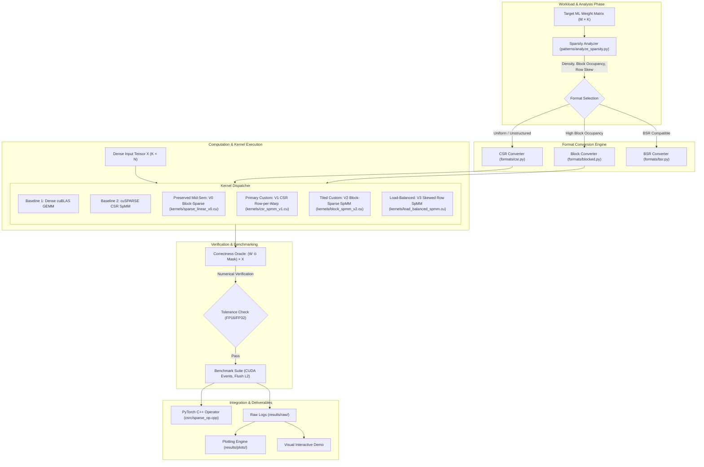

# System Architecture & Technical Specification

**Project:** Custom CUDA Kernel for Sparse Matrix Operations in ML Pipelines  
**Document Status:** Baselined (Phase 1)  
**Authoritative Reference:** Project 10, pages 21–22, `CUDA_GPU_Projects_1-10_Getting_Started.pdf`  

---

## 1. System Overview & End-to-End Pipeline

This project builds a specialized GPU computing pipeline that ingests sparse weight matrices from machine learning workloads, converts them into optimal compressed representations, and executes high-performance sparse matrix multiplication (SpMM) on NVIDIA GPU hardware.



---

## 2. Kernel Evolution & Lineage Taxonomy

To maintain strict scientific provenance, kernel variants are delineated into distinct evolutionary milestones:

| Kernel Identifier | Source File | Mathematical Format | GPU Mapping Strategy | Status | Purpose & Role |
| :--- | :--- | :--- | :--- | :--- | :--- |
| **V0 (Preserved Midsem)** | `kernels/sparse_linear_v0.cu` | 2-of-8 Block-Sparse (32×32 sub-blocks) | 2D CTA tile ($16\times 16$), thread cooperation | **Implemented, Unverified** | Preserved from mid-semester prototype. Serves as baseline for block-sparse concept. |
| **V1 (CSR Row-per-Warp)** | `kernels/csr_spmm_v1.cu` | Standard CSR (`values`, `col_indices`, `row_ptr`) | 1 warp (32 threads) per row of $A$; intra-warp shuffle reduction (`__shfl_down_sync`) | **Planned (Phase 2)** | Primary mandatory custom kernel satisfying Project 10 Core Specification. |
| **V2 (Block-Sparse Tiled)** | `kernels/block_spmm_v2.cu` | BSR / Structured Blocked ($B \times B$ tiles) | 2D threadblocks loading tiles into `__shared__` memory with double-buffering | **Planned (Phase 3)** | High-throughput kernel for workloads with clustered spatial non-zeros. |
| **V3 (Load-Balanced CSR)** | `kernels/load_balanced_spmm.cu` | CSR with Row-Length Binning / Segmented Scan | Dynamic work assignment; bin-partitioned CTA dispatch | **Planned (Phase 4)** | Eliminates warp divergence caused by power-law / Zipfian row distributions. |

> [!IMPORTANT]
> **V0 is NOT V1.** The existing V0 kernel implements an unverified 2-of-8 block-sparse design. It will not be renamed to V1 or claimed as satisfying the CSR row-per-warp requirement. It remains preserved under its true identity.

---

## 3. Hardware Architecture & Memory Hierarchy Mapping

The kernels are specifically targeted to the **NVIDIA GeForce RTX 3050 Laptop GPU** (Ampere Architecture, Compute Capability 8.6):

- **SM Configuration:** 16 Streaming Multiprocessors (SMs), 128 FP32 CUDA cores per SM, total 2048 CUDA cores.
- **Register File:** 64K 32-bit registers per SM.
- **Shared Memory / L1 Cache:** Configurable up to 100 KB per SM (128 KB total shared/L1 combined).
- **L2 Cache:** 2 MB on-chip shared across all SMs.
- **Device Memory:** 4 GB GDDR6 on a 128-bit memory bus with theoretical peak bandwidth $\sim 175\text{ GB/s}$.

### Architectural Design Principles for Ampere:
1. **Warp-Synchronous Communication:**  
   V1 uses `__shfl_down_sync(0xffffffff, sum, offset)` within each 32-thread warp to compute dot-product reductions in registers without round-trips to shared memory.
2. **Coalesced Global Memory Access:**  
   In CSR SpMM ($Y = A \times X$), non-zero columns of $A$ dictate the row indices fetched from $X$. For a fixed row non-zero, adjacent threads in a warp access consecutive columns of $X$, forming 128-byte coalesced memory transactions.
3. **L2 Cache Thrashing Prevention:**  
   Benchmarking includes explicit L2 cache eviction mechanisms (allocating and touching a 4 MB dummy buffer between runs) to accurately measure cold-cache vs warm-cache latencies.

---

## 4. Sparse Storage Formats

### 4.1 Compressed Sparse Row (CSR)
- `row_ptr` (int32, length $M + 1$): Prefix sum of row non-zero counts; `row_ptr[i+1] - row_ptr[i]` is the non-zero count of row $i$.
- `col_indices` (int32, length $NNZ$): Column coordinates of each non-zero value.
- `values` (float16 / float32, length $NNZ$): Floating-point payloads.

```
Dense Matrix (4x4):
[ 1.0  0.0  0.0  2.0 ]
[ 0.0  0.0  3.0  0.0 ]
[ 0.0  0.0  0.0  0.0 ]
[ 4.0  5.0  0.0  6.0 ]

CSR Representation:
values:      [ 1.0, 2.0, 3.0, 4.0, 5.0, 6.0 ]
col_indices: [ 0,   3,   2,   0,   1,   3   ]
row_ptr:     [ 0,   2,   3,   3,   6        ]
```

### 4.2 2-of-8 Block-Sparse (Preserved Midsem Format)
- Subdivides the matrix into 8-block columns where exactly 2 active blocks are retained per 8-block chunk based on $L_2$ norm.
- Compact storage using an index array and a packed payload buffer.

---

## 5. Correctness Oracle Architecture

Every custom kernel output $Y_{\text{custom}}$ is validated against the mathematical definition of masked-dense multiplication:

$$Y_{\text{oracle}} = (W \odot M) \cdot X$$

Where:
- $W \in \mathbb{R}^{M \times K}$ is the full weight matrix.
- $M \in \{0, 1\}^{M \times K}$ is the binary sparsity mask ($M_{ij} = 1$ if $(i,j)$ is non-zero).
- $X \in \mathbb{R}^{K \times N}$ is the dense input activation matrix.

### Verification Criteria:
$$\max \frac{|Y_{\text{custom}} - Y_{\text{oracle}}|}{|Y_{\text{oracle}}| + \epsilon} \le \text{tolerance}$$

- **FP32:** $\text{atol} = 10^{-5}, \text{rtol} = 10^{-4}$
- **FP16:** $\text{atol} = 10^{-3}, \text{rtol} = 10^{-2}$

---

## 6. PyTorch Integration Architecture

The PyTorch C++ extension (`csrc/sparse_op.cpp`) binds custom CUDA kernels into the PyTorch runtime:

```python
# Target PyTorch Usage Pattern
import torch
from formats.csr import dense_to_csr

class SparseLinear(torch.nn.Module):
    def __init__(self, in_features, out_features, csr_matrix):
        super().__init__()
        self.register_buffer("row_ptr", csr_matrix.row_ptr)
        self.register_buffer("col_indices", csr_matrix.col_indices)
        self.register_buffer("values", csr_matrix.values)
        self.M = in_features
        self.K = out_features

    def forward(self, x):
        # Calls the C++/CUDA binding
        return torch.ops.sparse_ops.csr_spmm(self.row_ptr, self.col_indices, self.values, x)
```

---

## 7. Custom Kernel V1 Detailed Design & Execution Mapping Reconciliation

### 7.1 Mathematical Specification
The operation to compute is sparse-matrix dense-matrix multiplication (SpMM):

$$Y[i, j] = \sum_{p = \text{row\_ptr}[i]}^{\text{row\_ptr}[i+1] - 1} \text{values}[p] \times X[\text{col\_indices}[p], j]$$

Where:
- $A_{\text{CSR}} \in \mathbb{R}^{M \times K}$ is stored in CSR format: `row_ptr` ($M+1$), `col_indices` ($NNZ$), `values` ($NNZ$).
- $X \in \mathbb{R}^{K \times N}$ is a dense row-major matrix: $X[k, j] = \text{data}[k \times N + j]$.
- $Y \in \mathbb{R}^{M \times N}$ is a dense row-major output matrix: $Y[i, j] = \text{data}[i \times N + j]$.
- In the investigated BERT-Base workload: $M = 3072, K = 768, N \in \{16, 32, 64, 128, 256, 512\}$.

---

### 7.2 Two Candidate Warp Execution Architectures

To resolve the architectural tension between intra-warp shuffle reduction and coalesced dense-input column reads, two distinct execution mappings are evaluated:

```
┌────────────────────────────────────────────────────────────────────────────────────────┐
│ MAPPING A: Nonzero-Parallel Warp (SpMV-derived)                                         │
│ • Warp assigned to (Row i, Column j)                                                   │
│ • 32 lanes split nonzeros: Lane t -> p = row_ptr[i] + t, step 32                       │
│ • CSR reads: Coalesced (adjacent lanes read adjacent nonzeros)                         │
│ • Dense X reads: UNCOALESCED GATHER (32 lanes read 32 distinct rows k_t of X)           │
│ • Accumulator: Partial sum per lane                                                    │
│ • Reduction: MANDATORY __shfl_down_sync across all 32 lanes                            │
│ • Output store: Lane 0 writes single 4-byte scalar Y[i, j] (uncoalesced)               │
└────────────────────────────────────────────────────────────────────────────────────────┘

┌────────────────────────────────────────────────────────────────────────────────────────┐
│ MAPPING B: Column-Coalesced Warp (SpMM-specialized, Recommended)                        │
│ • Warp assigned to (Row i, Column Tile [j_base .. j_base + 31])                        │
│ • 32 lanes split output columns: Lane t -> Column j = j_base + t                       │
│ • CSR reads: Sequential scalar traversal; broadcast (k, v) to warp                     │
│ • Dense X reads: 100% COALESCED (all 32 lanes read row k at cols j_base..j_base+31)    │
│ • Accumulator: Complete sum per lane for its output column                             │
│ • Reduction: ZERO INTRA-WARP REDUCTION (no __shfl_down_sync needed)                    │
│ • Output store: All 32 lanes write 32 consecutive floats -> 128-byte coalesced write  │
└────────────────────────────────────────────────────────────────────────────────────────┘
```

#### Detailed Comparison Across Engineering Criteria:

| Evaluation Criterion | Mapping A (Nonzero-Parallel Warp) | Mapping B (Column-Coalesced Warp) |
| :--- | :--- | :--- |
| **1. Thread Assignment** | Warp assigned to $(i, j)$; lane $t$ processes nonzeros $p = \text{start} + t, \text{stride } 32$. | Warp assigned to row $i$ and column tile $[j_{\text{base}}, j_{\text{base}} + 32)$; lane $t$ processes column $j = j_{\text{base}} + t$. |
| **2. Target Dimensions** | Optimal for $N = 1$ (SpMV). High overhead when $N \gg 1$. | Optimal for $N \ge 32$ (SpMM). Evaluates directly on Project 10 sweep ($N \in \{16, 32, 64, 128, 256, 512\}$). |
| **3. Accumulator Semantics** | Lane $t$ maintains a *partial sum* $\sum_{p \in \text{slice}} v_p X_{k_p, j}$. | Lane $t$ maintains the *complete inner product* for output element $Y[i, j_{\text{base}} + t]$. |
| **4. CSR Array Accesses** | Coalesced: lanes $0..31$ load 32 consecutive indices and values. Diverges when $NNZ < 32$. | Scalar broadcast: warp reads one $(k, v)$ per non-zero iteration and broadcasts to all lanes via `__shfl_sync` or L1 uniform cache. |
| **5. Dense $X$ Memory Access** | **Uncoalesced Gather:** 32 lanes load $X[k_t, j]$ from 32 distinct rows. Addresses are scattered across up to 32 separate cache lines, causing severe memory transaction inflation. | **100% Coalesced Load:** All 32 lanes load row $k$ at adjacent columns $j_{\text{base}} + 0 \dots 31$. Forms a single, perfectly aligned 128-byte global memory transaction. |
| **6. Empty / Irregular Rows** | Empty rows skip the loop but all 32 threads still execute the 5-step shuffle reduction to yield $0.0$. Short rows ($NNZ < 32$) leave up to 75% of lanes idle. | Empty rows execute loop 0 times and immediately store $0.0$ in 1 cycle. For irregular rows, all 32 lanes remain 100% active during the row's traversal. |
| **7. Reduction / Broadcast** | **Requires 5-step `__shfl_down_sync`** tree reduction across the warp. Only Lane 0 writes output (4-byte store). | **Requires zero intra-warp reduction.** Requires scalar broadcast of $(k, v)$ each step. Stores to $Y$ are **100% coalesced 128-byte writes**. |
| **8. Performance Tradeoffs** | Memory-bound by scattered L1/L2 cache line reads from $X$; wastefully evaluates shuffle reduction for every element. | Maximizes Ampere memory bus saturation (128 bytes/cycle per warp load and store); eliminates warp reduction instructions entirely. |

---

### 7.3 Technical Tradeoff Analysis & Design Decision for CSR V1

1. **Why Mapping A was Previously Documented:**  
   Mapping A is the classical algorithm for Sparse Matrix-Vector multiplication (SpMV, where $N=1$). In SpMV, there is only a single output column, making parallelization across columns impossible. In that restricted regime, distributing nonzeros across the 32 warp lanes and reducing with `__shfl_down_sync` is mandatory.
2. **The Project 10 SpMM Context ($N \ge 32$):**  
   In ML inference workloads (including BERT intermediate dense projections), input activations are batched tokens where $N \in \{16, 32, 64, 128, 256, 512\}$. In this regime, the primary performance bottleneck on Ampere architecture is global memory bandwidth saturation.
3. **Reconciled Decision for Kernel V1:**  
   - **Primary Implementation:** **Mapping B (Column-Coalesced SpMM)** is selected as the definitive architecture for Custom Kernel V1. It provides 100% coalesced 128-byte loads from dense matrix $X$, 100% coalesced 128-byte stores to output matrix $Y$, and completely eliminates intra-warp reduction overhead.
   - **Role of `__shfl_down_sync`:** Warp shuffle reduction intrinsics are **not forced** into Kernel V1 simply for compliance with preliminary notes when the mathematical mapping does not require reduction across lanes. Shuffle intrinsics are reserved for sub-warp reductions if $N < 32$ or when evaluating candidate SpMV-style kernels.

---

### 7.4 Implementation Blueprint for V1 (Mapping B)

```cpp
// Kernel execution model: Mapping B (Column-Coalesced SpMM)
template <typename scalar_t>
__global__ void csr_spmm_v1_kernel(
    const int* __restrict__ row_ptr,      // [M + 1]
    const int* __restrict__ col_indices,  // [NNZ]
    const scalar_t* __restrict__ values,  // [NNZ]
    const scalar_t* __restrict__ X,       // [K, N] (row-major)
    scalar_t* __restrict__ Y,             // [M, N] (row-major)
    int M, int K, int N
) {
    // 4 warps per block (128 threads)
    const int warp_id = threadIdx.x / 32;
    const int lane_id = threadIdx.x % 32;

    // Row assignment: one warp per sparse row
    const int row = blockIdx.x * 4 + warp_id;
    if (row >= M) return;

    // Column tile: 32 columns per warp
    const int col_start = blockIdx.y * 32;
    const int col = col_start + lane_id;

    // Each lane maintains complete accumulator for output Y[row, col]
    float acc = 0.0f;

    const int row_start = row_ptr[row];
    const int row_end   = row_ptr[row + 1];

    // Traverse nonzeros of row sequentially; all lanes execute in lockstep
    for (int p = row_start; p < row_end; ++p) {
        // Broadcast sparse nonzero metadata across warp
        const int col_idx = col_indices[p];
        const float val   = static_cast<float>(values[p]);

        // Perfectly coalesced 128-byte load from dense matrix X across 32 lanes
        if (col < N) {
            const float x_val = static_cast<float>(X[col_idx * N + col]);
            acc += val * x_val;
        }
    }

    // Perfectly coalesced 128-byte store to output matrix Y across 32 lanes
    if (col < N) {
        Y[row * N + col] = static_cast<scalar_t>(acc);
    }
}
```

### 7.5 Launch Configuration & Dimension Handling
- **Block Dimensions:** `dim3 block(128, 1, 1)` (4 warps = 128 threads per CTA).
- **Grid Dimensions:**
  - `grid.x = (M + 3) / 4` (assigns 4 rows per block).
  - `grid.y = (N + 31) / 32` (decomposes column dimension $N$ into 32-column tiles).
- **Sub-32 Column Support ($N = 16$):**
  - Handled safely via the `if (col < N)` lane mask. Alternatively, two rows can be packed into a single warp (lanes 0–15 process row $i$, lanes 16–31 process row $i+1$).

### 7.6 Precision & Dtype Support
- **FP32 Mode:** Input $A$ is FP32, $X$ is FP32, accumulation in FP32 register, output $Y$ is FP32.
- **FP16 Mode:** Input $A$ is FP16 (`__half`), $X$ is FP16 (`__half`), accumulation in FP32 (`float`) to guard against catastrophic underflow and overflow, output converted back to FP16.

### 7.7 Deferred Optimizations
To preserve clean verification gates, advanced optimizations remain explicitly deferred:
- Shared memory tile caching ($X$ double-buffering) $\to$ Deferred to **V2 (Block-Sparse)**.
- Dynamic row binning and segmented scan $\to$ Deferred to **V3 (Load-Balanced)**.
- Ampere Tensor Core 2:4 structured MMA $\to$ Deferred to **Optional Phase (R12)**.

