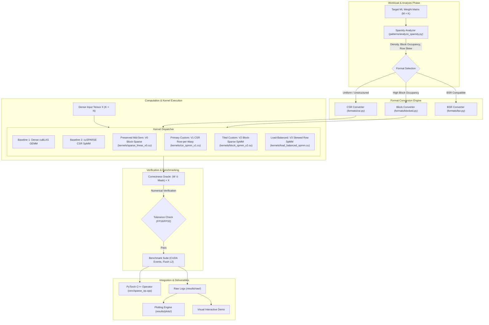

# System Architecture & Technical Specification

**Project:** Custom CUDA Kernel for Sparse Matrix Operations in ML Pipelines  
**Document Status:** Baselined (Phase 1)  
**Authoritative Reference:** Project 10, pages 21–22, `CUDA_GPU_Projects_1-10_Getting_Started.pdf`  

---

## 1. System Overview & End-to-End Pipeline

This project builds a specialized GPU computing pipeline that ingests sparse weight matrices from machine learning workloads, converts them into optimal compressed representations, and executes high-performance sparse matrix multiplication (SpMM) on NVIDIA GPU hardware.



---

## 2. Kernel Evolution & Lineage Taxonomy

To maintain strict scientific provenance, kernel variants are delineated into distinct evolutionary milestones:

| Kernel Identifier | Source File | Mathematical Format | GPU Mapping Strategy | Status | Purpose & Role |
| :--- | :--- | :--- | :--- | :--- | :--- |
| **V0 (Preserved Midsem)** | `kernels/sparse_linear_v0.cu` | 2-of-8 Block-Sparse (32×32 sub-blocks) | 2D CTA tile ($16\times 16$), thread cooperation | **Implemented, Unverified** | Preserved from mid-semester prototype. Serves as baseline for block-sparse concept. |
| **V1 (CSR Row-per-Warp)** | `kernels/csr_spmm_v1.cu` | Standard CSR (`values`, `col_indices`, `row_ptr`) | 1 warp (32 threads) per row of $A$; intra-warp shuffle reduction (`__shfl_down_sync`) | **Planned (Phase 2)** | Primary mandatory custom kernel satisfying Project 10 Core Specification. |
| **V2 (Block-Sparse Tiled)** | `kernels/block_spmm_v2.cu` | BSR / Structured Blocked ($B \times B$ tiles) | 2D threadblocks loading tiles into `__shared__` memory with double-buffering | **Planned (Phase 3)** | High-throughput kernel for workloads with clustered spatial non-zeros. |
| **V3 (Load-Balanced CSR)** | `kernels/load_balanced_spmm.cu` | CSR with Row-Length Binning / Segmented Scan | Dynamic work assignment; bin-partitioned CTA dispatch | **Planned (Phase 4)** | Eliminates warp divergence caused by power-law / Zipfian row distributions. |

> [!IMPORTANT]
> **V0 is NOT V1.** The existing V0 kernel implements an unverified 2-of-8 block-sparse design. It will not be renamed to V1 or claimed as satisfying the CSR row-per-warp requirement. It remains preserved under its true identity.

---

## 3. Hardware Architecture & Memory Hierarchy Mapping

The kernels are specifically targeted to the **NVIDIA GeForce RTX 3050 Laptop GPU** (Ampere Architecture, Compute Capability 8.6):

- **SM Configuration:** 16 Streaming Multiprocessors (SMs), 128 FP32 CUDA cores per SM, total 2048 CUDA cores.
- **Register File:** 64K 32-bit registers per SM.
- **Shared Memory / L1 Cache:** Configurable up to 100 KB per SM (128 KB total shared/L1 combined).
- **L2 Cache:** 2 MB on-chip shared across all SMs.
- **Device Memory:** 4 GB GDDR6 on a 128-bit memory bus with theoretical peak bandwidth $\sim 175\text{ GB/s}$.

### Architectural Design Principles for Ampere:
1. **Warp-Synchronous Communication:**  
   V1 uses `__shfl_down_sync(0xffffffff, sum, offset)` within each 32-thread warp to compute dot-product reductions in registers without round-trips to shared memory.
2. **Coalesced Global Memory Access:**  
   In CSR SpMM ($Y = A \times X$), non-zero columns of $A$ dictate the row indices fetched from $X$. For a fixed row non-zero, adjacent threads in a warp access consecutive columns of $X$, forming 128-byte coalesced memory transactions.
3. **L2 Cache Thrashing Prevention:**  
   Benchmarking includes explicit L2 cache eviction mechanisms (allocating and touching a 4 MB dummy buffer between runs) to accurately measure cold-cache vs warm-cache latencies.

---

## 4. Sparse Storage Formats

### 4.1 Compressed Sparse Row (CSR)
- `row_ptr` (int32, length $M + 1$): Prefix sum of row non-zero counts; `row_ptr[i+1] - row_ptr[i]` is the non-zero count of row $i$.
- `col_indices` (int32, length $NNZ$): Column coordinates of each non-zero value.
- `values` (float16 / float32, length $NNZ$): Floating-point payloads.

```
Dense Matrix (4x4):
[ 1.0  0.0  0.0  2.0 ]
[ 0.0  0.0  3.0  0.0 ]
[ 0.0  0.0  0.0  0.0 ]
[ 4.0  5.0  0.0  6.0 ]

CSR Representation:
values:      [ 1.0, 2.0, 3.0, 4.0, 5.0, 6.0 ]
col_indices: [ 0,   3,   2,   0,   1,   3   ]
row_ptr:     [ 0,   2,   3,   3,   6        ]
```

### 4.2 2-of-8 Block-Sparse (Preserved Midsem Format)
- Subdivides the matrix into 8-block columns where exactly 2 active blocks are retained per 8-block chunk based on $L_2$ norm.
- Compact storage using an index array and a packed payload buffer.

---

## 5. Correctness Oracle Architecture

Every custom kernel output $Y_{\text{custom}}$ is validated against the mathematical definition of masked-dense multiplication:

$$Y_{\text{oracle}} = (W \odot M) \cdot X$$

Where:
- $W \in \mathbb{R}^{M \times K}$ is the full weight matrix.
- $M \in \{0, 1\}^{M \times K}$ is the binary sparsity mask ($M_{ij} = 1$ if $(i,j)$ is non-zero).
- $X \in \mathbb{R}^{K \times N}$ is the dense input activation matrix.

### Verification Criteria:
$$\max \frac{|Y_{\text{custom}} - Y_{\text{oracle}}|}{|Y_{\text{oracle}}| + \epsilon} \le \text{tolerance}$$

- **FP32:** $\text{atol} = 10^{-5}, \text{rtol} = 10^{-4}$
- **FP16:** $\text{atol} = 10^{-3}, \text{rtol} = 10^{-2}$

---

## 6. PyTorch Integration Architecture

The PyTorch C++ extension (`csrc/sparse_op.cpp`) binds custom CUDA kernels into the PyTorch runtime:

```python
# Target PyTorch Usage Pattern
import torch
from formats.csr import dense_to_csr

class SparseLinear(torch.nn.Module):
    def __init__(self, in_features, out_features, csr_matrix):
        super().__init__()
        self.register_buffer("row_ptr", csr_matrix.row_ptr)
        self.register_buffer("col_indices", csr_matrix.col_indices)
        self.register_buffer("values", csr_matrix.values)
        self.M = in_features
        self.K = out_features

    def forward(self, x):
        # Calls the C++/CUDA binding
        return torch.ops.sparse_ops.csr_spmm(self.row_ptr, self.col_indices, self.values, x)
```
