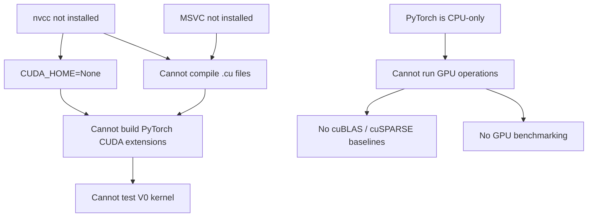

# Project 10 — Phase 0 Diagnostic Report

**Date:** 2026-10-21  
**Environment:** Windows 11 native (not WSL, not container)  
**Workspace:** `c:\Users\nikit\OneDrive\Desktop\EDI_CUDA`

---

## A. Environment Summary

| Component | Value | Status |
|---|---|---|
| **Operating System** | Windows 11 Home (Build 26200), x64 | ✅ Verified |
| **GPU** | NVIDIA GeForce RTX 3050 Laptop GPU | ✅ Verified via `nvidia-smi` |
| **GPU VRAM** | 4096 MiB | ✅ Verified |
| **Compute Capability** | 8.6 (Ampere) | ✅ Verified |
| **NVIDIA Driver** | 566.07 | ✅ Verified |
| **Driver CUDA Version** | 12.7 (max supported) | ✅ Verified via `nvidia-smi` |
| **CUDA Toolkit (`nvcc`)** | **NOT INSTALLED** | ❌ Not found anywhere on system |
| **CUDA_HOME env var** | Not set | ❌ |
| **Python** | 3.13.0 | ✅ Verified |
| **PyTorch** | 2.10.0+**cpu** | ⚠️ CPU-only build — `torch.cuda.is_available() = False`, `torch.backends.cuda.is_built() = False`, `torch.version.cuda = None` |
| **torchvision** | 0.25.0 | ✅ Installed |
| **numpy** | 2.2.1 | ✅ Installed |
| **scipy** | 1.17.0 | ✅ Installed |
| **pytest** | 8.3.4 | ✅ Verified (17/17 CPU tests pass) |
| **setuptools** | 75.8.0 | ✅ Installed |
| **CMake** | 4.0.2 | ✅ Verified (`C:\Program Files\CMake\bin\cmake.exe`) |
| **g++ (MSYS2)** | 15.1.0 | ✅ Available, but MSYS2 `g++` is **not compatible with `nvcc`** on Windows |
| **MSVC (`cl.exe`)** | **NOT INSTALLED** | ❌ Visual Studio not found |
| **cuBLAS** | Not available (no CUDA PyTorch, no toolkit) | ❌ Blocked |
| **cuSPARSE** | Not available (no CUDA PyTorch, no toolkit) | ❌ Blocked |
| **cuSPARSELt** | Not available | ❌ Blocked (also requires Ampere+; GPU qualifies, but no toolkit) |
| **Nsight Compute (`ncu`)** | **NOT INSTALLED** | ❌ |
| **Nsight Systems (`nsys`)** | **NOT INSTALLED** | ❌ |
| **Compute Sanitizer** | **NOT INSTALLED** | ❌ |
| **PyTorch `CUDAExtension`** | API exists in package, but `CUDA_HOME = None`; **cannot build** | ❌ Blocked |
| **PyTorch sparse CSR API** | `torch.sparse.mm` exists; `to_sparse_csr()` works on CPU | ⚠️ CPU-only; CUDA sparse path blocked |
| **Git** | Available but **no `.git` repository** exists in workspace or subdirectory | ⚠️ |

### Key Environment Blockers

> [!CAUTION]
> **Three critical components are missing** that prevent any GPU-side work:
> 1. **CUDA Toolkit** — `nvcc` is not installed; no `CUDA_HOME`; no CUDA development libraries on this system.
> 2. **CUDA-enabled PyTorch** — Current install is `torch 2.10.0+cpu`. It cannot run GPU operations, call cuBLAS/cuSPARSE, or build CUDA extensions.
> 3. **MSVC compiler** — `nvcc` on Windows requires MSVC (`cl.exe`); the available MSYS2 `g++` is not a compatible host compiler.

---

## B. Repository Audit

### Structure

The workspace is a flat directory (`EDI_CUDA`), **not** a Git repository. It contains:

```
EDI_CUDA/
├── CUDA_GPU_Projects_1-10_Getting_Started.pdf     # 56 KB — project spec
├── PROJECT10_REQUIREMENTS_ARCHITECTURE.md          # 11 KB — detailed requirements
└── sparse-cuda-midsem/                             # mid-semester prototype
    ├── .gitignore
    ├── README.md
    ├── requirements-dev.txt
    ├── run_cpu_tests.sh
    ├── configs/
    │   └── demo_config.yaml
    ├── csrc/
    │   ├── sparse_op.cpp          # TORCH_LIBRARY registration
    │   └── sparse_op.h            # header for sparse_linear_cuda
    ├── kernels/
    │   └── sparse_linear_v0.cu    # V0 block-sparse kernel (2-of-8, 32×32)
    ├── python/
    │   ├── __init__.py
    │   ├── build_extension.py     # setuptools CUDAExtension build script
    │   └── sparse_format.py       # Packed2of8 pack/unpack
    ├── bench/
    │   ├── benchmark_dense.py     # CUDA-event dense matmul benchmark
    │   ├── benchmark_custom.py    # CUDA-event custom kernel benchmark
    │   └── cusparse_spmm_baseline.cu  # scaffold only — prints CUSPARSE_VERSION
    ├── tests/
    │   ├── test_packer.py         # 2 tests — structure & norm selection
    │   ├── test_cpu_reference.py  # 15 tests — matmul correctness + roundtrip + edge cases
    │   └── test_cuda_kernel.py    # 1 test — GPU correctness (skip if no CUDA)
    ├── scripts/
    │   ├── check_environment.py
    │   ├── check_environment.ps1
    │   └── check_cuda_env.sh
    ├── profiling/
    │   └── README.md              # Nsight command templates
    ├── results/
    │   ├── demo_profile.json      # placeholder (is_demo: true)
    │   └── environment_current.txt # stale — from a different Linux machine
    └── docs/
        ├── DEVELOPMENT_CHECKLIST.md
        ├── FILE_INDEX.txt
        ├── MIDSEM_EVIDENCE.md
        └── PPT_CLAIM_GUARD.md
```

### Existing Implementation Assessment

| Component | Status | Notes |
|---|---|---|
| **2-of-8 block-sparse format** | ✅ Implemented | [`sparse_format.py`](file:///c:/Users/nikit/OneDrive/Desktop/EDI_CUDA/sparse-cuda-midsem/python/sparse_format.py): `pack_2of8_block_sparse` / `unpack_2of8_block_sparse`, hardcoded to 32×32 blocks, groups of 8, active 2 |
| **CPU correctness tests** | ✅ 17/17 pass | Packer structure, norm selection, matmul roundtrip, FP16, edge cases |
| **V0 CUDA kernel** | ✅ Source exists | [`sparse_linear_v0.cu`](file:///c:/Users/nikit/OneDrive/Desktop/EDI_CUDA/sparse-cuda-midsem/kernels/sparse_linear_v0.cu): one-CTA-per-16×16-tile, FP16 input, FP32 accumulation, hardcoded `BS=32, GB=8, AB=2` |
| **PyTorch operator binding** | ✅ Source exists | [`sparse_op.cpp`](file:///c:/Users/nikit/OneDrive/Desktop/EDI_CUDA/sparse-cuda-midsem/csrc/sparse_op.cpp): `TORCH_LIBRARY(sparse_cuda, ...)` with `sparse_cuda.linear` |
| **Extension build script** | ✅ Source exists | [`build_extension.py`](file:///c:/Users/nikit/OneDrive/Desktop/EDI_CUDA/sparse-cuda-midsem/python/build_extension.py): `CUDAExtension` setup |
| **Dense benchmark harness** | ✅ Source exists | [`benchmark_dense.py`](file:///c:/Users/nikit/OneDrive/Desktop/EDI_CUDA/sparse-cuda-midsem/bench/benchmark_dense.py): warmup + CUDA events + median/p90 |
| **Custom kernel benchmark** | ✅ Source exists | [`benchmark_custom.py`](file:///c:/Users/nikit/OneDrive/Desktop/EDI_CUDA/sparse-cuda-midsem/bench/benchmark_custom.py): warmup + CUDA events |
| **cuSPARSE baseline** | ⚠️ Scaffold only | [`cusparse_spmm_baseline.cu`](file:///c:/Users/nikit/OneDrive/Desktop/EDI_CUDA/sparse-cuda-midsem/bench/cusparse_spmm_baseline.cu): prints version constant, no actual SpMM |
| **CUDA kernel compiled/tested** | ❌ Never compiled | No build artifacts (`.so`, `.pyd`, build/) anywhere |
| **Benchmark results** | ❌ None measured | `demo_profile.json` is self-labeled as `is_demo: true` |
| **CSR format converter** | ❌ Not implemented | Required by R2, R4, R5 |
| **BSR format converter** | ❌ Not implemented | Required by R2 for block-sparse comparison |
| **CSR row-per-warp SpMM kernel (V1)** | ❌ Not implemented | Required by R5 — this is the **first** required custom kernel per the project spec |
| **Sparsity analyzer** | ❌ Not implemented | Required by R1 |
| **Workload characterization** | ❌ Not done | Required by R1 |
| **Git repository** | ❌ Not initialized | No version control |

### What Must Be Preserved

All existing code in `sparse-cuda-midsem/` represents valid mid-semester work. The 2-of-8 block-sparse packer, V0 kernel, tests, and benchmarks should be preserved but understood as:
- The **2-of-8 / 32×32 pattern is a candidate** (the docs say so explicitly), not a confirmed workload match.
- The V0 kernel is a block-sparse variant, **not** the CSR row-per-warp kernel required by R5 as the first custom kernel.
- None of the GPU-dependent code has ever been compiled or executed.

---

## C. Workload Availability

### Available Evidence

| Attribute | What exists | Source |
|---|---|---|
| Candidate pattern | 2-of-8 block sparsity, 32×32 blocks | `demo_config.yaml`, `sparse_format.py` |
| Candidate dimensions | M=1024, K=1024 | `demo_profile.json` (labeled as demo) |
| Candidate dtype | FP16 | `demo_config.yaml` |
| Block sparsity | 75% (6 of 8 blocks zeroed) | Computed from 2/8 ratio |

### What Is **Missing**

> [!WARNING]
> **No real target workload exists in this workspace.**

- ❌ No model checkpoints (`.pt`, `.pth`, `.onnx`, `.safetensors`, `.bin`)
- ❌ No weight matrices or saved tensors
- ❌ No sparsity masks
- ❌ No pruned model outputs
- ❌ No workload configuration file pointing to a real model/layer
- ❌ No sparsity profiling results
- ❌ No evidence of which ML model or layer is the actual target
- ❌ No measured nonzero counts, row-length distribution, or block occupancy

### Critical Unknown Facts

| Fact | Status |
|---|---|
| Target model identity | **Unknown** |
| Target layer(s) | **Unknown** |
| Actual matrix dimensions (M, K) | **Unknown** — 1024×1024 is a demo placeholder |
| Actual sparsity percentage | **Unknown** |
| Actual sparsity structure (unstructured vs block vs 2:4) | **Unknown** |
| Row-length distribution | **Unknown** |
| Weight dtype in production | **Unknown** |
| Inference batch size | **Unknown** |
| Whether weights are already pruned | **Unknown** |

---

## D. Baseline Feasibility

| Baseline / Capability | Status | Blocker |
|---|---|---|
| **Dense matmul via cuBLAS/PyTorch** | ❌ **Blocked** | PyTorch is CPU-only; `torch.cuda.is_available() = False` |
| **CSR SpMM via cuSPARSE/PyTorch** | ❌ **Blocked** | Same — CPU-only PyTorch has no GPU sparse path |
| **Custom CUDA kernel compilation** | ❌ **Blocked** | No CUDA Toolkit (`nvcc`), no MSVC (`cl.exe`) |
| **PyTorch C++/CUDA extension build** | ❌ **Blocked** | `CUDA_HOME = None`, no `nvcc`, no MSVC |
| **Automated correctness tests (CPU)** | ✅ **Working** | 17/17 tests pass for pack/unpack/matmul on CPU |
| **Automated correctness tests (GPU)** | ❌ **Blocked** | `test_cuda_kernel.py` correctly skips (no CUDA) |
| **CUDA-event benchmarking** | ❌ **Blocked** | No CUDA PyTorch |
| **Nsight Compute profiling** | ❌ **Blocked** | `ncu` not installed |
| **Nsight Systems profiling** | ❌ **Blocked** | `nsys` not installed |
| **Compute Sanitizer** | ❌ **Blocked** | Not installed |

### Summary of Blockers



---

## E. Decisions We Can Make Now

These decisions are justified by inspected evidence:

1. **Repository structure:** Adopt the layout from [PROJECT10_REQUIREMENTS_ARCHITECTURE.md](file:///c:/Users/nikit/OneDrive/Desktop/EDI_CUDA/PROJECT10_REQUIREMENTS_ARCHITECTURE.md) §7, incorporating existing `sparse-cuda-midsem/` code into the new structure.

2. **Git initialization:** The workspace has no version control. A Git repository should be initialized immediately to track all existing and new work.

3. **CSR format is the first-required format:** R2/R4/R5 all require CSR. The existing 2-of-8 block format is useful later but CSR converters and CSR SpMM come first in the project plan.

4. **V0 kernel is V2-class (block-sparse), not V1:** Per the project requirements, V1 is a CSR row-per-warp kernel. The existing V0 kernel maps to the block-sparse V2/V6 track and should be preserved as such.

5. **GPU hardware is adequate:** RTX 3050 Laptop (compute 8.6, Ampere) supports all required CUDA features including Tensor Cores and, in principle, cuSPARSELt 2:4 structured sparsity.

6. **The test suite is sound:** The 17 CPU tests provide a solid correctness foundation for the packing format and can be extended for CSR/BSR converters.

7. **Correctness oracle design:** `A_masked @ X` (dense multiplication on the pruned matrix) is already implemented via `unpack_2of8_block_sparse` → `matmul`. The same pattern applies to CSR.

---

## F. Decisions We Must Defer

These decisions **cannot** be made responsibly without additional information or environment fixes:

| Decision | Why it must wait |
|---|---|
| **Target sparsity pattern** | No real model weights/masks are available; cannot measure actual sparsity |
| **Block size selection** | Depends on observed block occupancy in the real workload |
| **Final matrix dimensions** (M, K) | Depends on the target model layer |
| **Whether to use 2:4 structured sparsity** | Depends on whether the real workload exhibits or can be pruned to 2:4; GPU supports it (Ampere) |
| **Optimization path** (shared-memory tiling, MMA, etc.) | Depends on Nsight profiling of V1 kernel, which requires a working CUDA environment |
| **cuSPARSELt baseline inclusion** | Depends on toolkit availability and whether 2:4 is relevant to the workload |
| **Performance claims of any kind** | Zero GPU execution has occurred |
| **Benchmark protocol tuning** (warmup, iterations) | Cannot validate until GPU runs work |

---

## G. Recommended Next Actions

Ordered by priority — each step unblocks subsequent ones:

### Phase 0.1 — Fix the Development Environment (Highest Priority)

| Step | Action | Why |
|---|---|---|
| **G1** | **Install CUDA Toolkit 12.x** (12.4 or 12.6 recommended) from [developer.nvidia.com](https://developer.nvidia.com/cuda-downloads). Ensure `nvcc` is on PATH and `CUDA_HOME` is set. | Unblocks all CUDA compilation. |
| **G2** | **Install Visual Studio 2022 Build Tools** with the "Desktop development with C++" workload (provides `cl.exe`). | Required by `nvcc` on Windows as the host compiler. |
| **G3** | **Install CUDA-enabled PyTorch** — `pip install torch torchvision --index-url https://download.pytorch.org/whl/cu124` (match your CUDA toolkit version). | Unblocks `torch.cuda.is_available()`, cuBLAS, cuSPARSE, extension building. |
| **G4** | Verify the full chain: `nvcc --version`, `python -c "import torch; print(torch.cuda.is_available())"`, and build the existing extension with `python python/build_extension.py build_ext --inplace`. | End-to-end compilation + GPU execution proof. |

### Phase 0.2 — Repository Foundation

| Step | Action |
|---|---|
| **G5** | Initialize Git: `git init`, add `.gitignore`, commit all existing work as the baseline. |
| **G6** | Restructure to the §7 layout from `PROJECT10_REQUIREMENTS_ARCHITECTURE.md`, preserving existing code. |
| **G7** | Move `PROJECT10_REQUIREMENTS_ARCHITECTURE.md` into `docs/`. |

### Phase 0.3 — Workload Selection

| Step | Action |
|---|---|
| **G8** | Select a concrete target model and layer (e.g., a linear layer from a known model like BERT, GPT-2, ResNet, ViT). Document the chosen model, layer name, weight shape, and dtype. |
| **G9** | Download or extract the target weights (`.pt` / `.safetensors`). |
| **G10** | Implement `patterns/analyze_sparsity.py` (R1): measure dimensions, dtype, nonzero count, sparsity %, block occupancy, row-length distribution. |
| **G11** | Based on the sparsity analysis results, freeze the sparse format decision (CSR, BSR, or custom blocked). |

### Phase 0.4 — First Testable Vertical Slice

| Step | Action |
|---|---|
| **G12** | Implement CSR converter (`formats/csr.py`) with correctness tests. |
| **G13** | Implement the masked-dense correctness oracle (`A_masked @ X`). |
| **G14** | Run the dense cuBLAS baseline (`bench/benchmark_dense.py`) and record raw results. |
| **G15** | Run the cuSPARSE CSR baseline (via `torch.sparse.mm` on CUDA) and record raw results. |
| **G16** | Implement and test the CSR row-per-warp SpMM kernel (V1) — this is the **first required custom kernel**. |
| **G17** | Generate the first comparison table: dense vs cuSPARSE vs custom V1. |

---

## H. Evidence Log

| # | Command / Check | Actual Output Summary |
|---|---|---|
| 1 | `list_dir EDI_CUDA/` | 2 files + 1 subdirectory (`sparse-cuda-midsem/`) |
| 2 | `git status` (workspace root) | `fatal: not a git repository` |
| 3 | `git status` (sparse-cuda-midsem/) | `fatal: not a git repository` |
| 4 | `systeminfo \| Select-String ...` | Windows 11 Home Build 26200, x64, single processor |
| 5 | `nvidia-smi` | RTX 3050 Laptop GPU, Driver 566.07, CUDA 12.7, 4096 MiB, 851 MiB used |
| 6 | `nvidia-smi --query-gpu=...` | `NVIDIA GeForce RTX 3050 Laptop GPU, 8.6, 4096 MiB, 566.07` |
| 7 | `nvcc --version` | `nvcc: The term 'nvcc' is not recognized` |
| 8 | `where.exe nvcc` | Not found |
| 9 | Recursive search for `nvcc.exe` in `Program Files` | Not found |
| 10 | `CUDA_HOME` / CUDA env vars | Not set |
| 11 | PATH entries matching CUDA/nvidia | Only PhysX and NvDLISR (no toolkit) |
| 12 | CUDA Toolkit install dir (`C:\Program Files\NVIDIA GPU Computing Toolkit\CUDA`) | Not found |
| 13 | `python --version` | Python 3.13.0 |
| 14 | PyTorch CUDA check | `2.10.0+cpu`, `cuda_available=False`, `cuda_version=None`, `is_built()=False` |
| 15 | `torch.sparse CSR` | `to_sparse_csr()` works on CPU; `torch.sparse.mm` exists |
| 16 | `torch.utils.cpp_extension` | `CUDAExtension` class exists, `CUDA_HOME=None` |
| 17 | `where.exe cl` | Not found |
| 18 | `vswhere` / Visual Studio dirs | Not found |
| 19 | `where.exe cmake` | `C:\Program Files\CMake\bin\cmake.exe`, version 4.0.2 |
| 20 | `g++ --version` | MSYS2 g++ 15.1.0 (not compatible with `nvcc` on Windows) |
| 21 | `where.exe ncu / nsys / compute-sanitizer` | None found |
| 22 | `pip list \| grep torch/cuda/numpy/pytest/setuptools` | torch 2.10.0 (cpu), numpy 2.2.1, scipy 1.17.0, pytest 8.3.4, setuptools 75.8.0 |
| 23 | Search for `.pt/.pth/.onnx/.bin/.safetensors/.npz/.npy` files | None found |
| 24 | `python -m pytest tests/test_packer.py tests/test_cpu_reference.py -v` | **17 passed** in 3.08s |
| 25 | Read all source files in `sparse-cuda-midsem/` | Full contents inspected (see §B) |
| 26 | Read `demo_profile.json` | Self-labeled `is_demo: true` — no real measurements |
| 27 | Read `environment_current.txt` | Stale — recorded from a different Linux machine with CPU-only PyTorch |

---

> [!IMPORTANT]
> **Bottom line:** The workspace contains a well-structured mid-semester prototype with working CPU tests, but **zero GPU capability exists in this environment**. The three mandatory installations (CUDA Toolkit, MSVC, CUDA-enabled PyTorch) must be completed before any implementation work can proceed on the GPU side. No real target workload has been selected or profiled.
